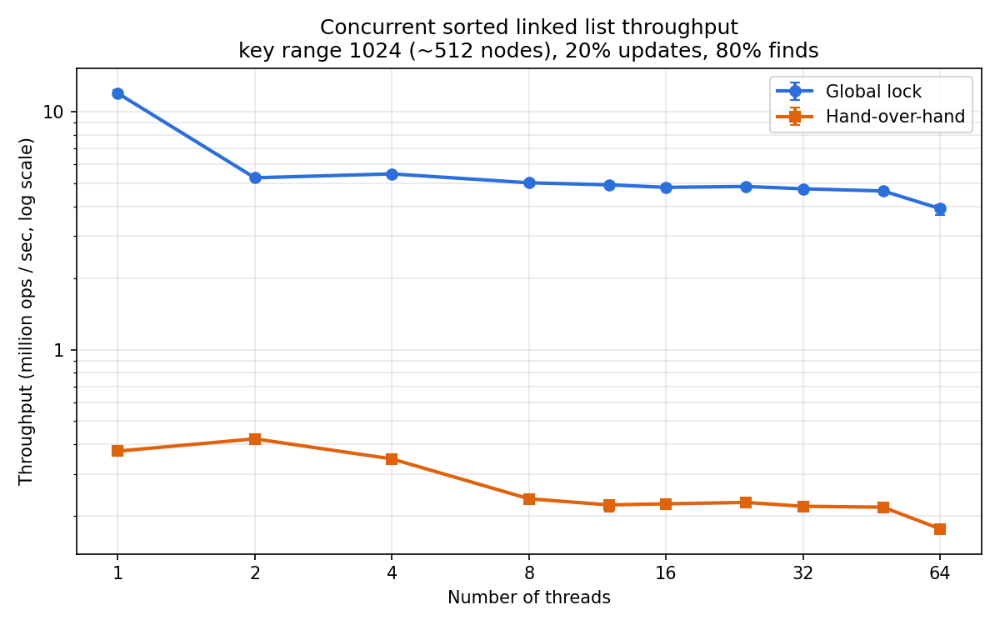

# Assignment 5 - Concurrent Linked Lists

Two thread-safe sorted linked lists from Lecture 17-18, in C++17:

| File | List |
|------|------|
| `src/global_lock_list.hpp` | Coarse-grained list: one global mutex held for the whole operation |
| `src/hoh_list.hpp` | Hand-over-hand (lock coupling) list: one mutex per node |

Both use sentinel head (`INT_MIN`) and tail (`INT_MAX`) nodes and support `insert`, `remove` and `find`.

## Build

```
make            # or: mingw32-make on Windows
```

This builds `test` (correctness test) and `bench` (throughput benchmark).

## Correctness test

```
./test
```

Threads run random insert/remove/find on a small key range. At the end, the list size must equal successful inserts minus successful removes, and the list must still be sorted.

## Benchmark

```
./bench <global|hoh> <threads> [duration_ms=1000] [key_range=1024] [update_pct=20]
```

The list is pre-filled with `key_range/2` keys. Then each thread runs random operations for `duration_ms`. Of these, `update_pct`% are updates (half inserts, half removes) and the rest are finds. The benchmark prints throughput in ops/sec.

Full sweep (1-64 threads, 3 trials each) and plot:

```
python scripts/run_bench.py      # -> results/results.csv
python scripts/plot.py           # -> results/throughput.png
```

## Results



Measured on a 16-thread machine with ~512 nodes, 80% finds and 20% updates. The global-lock list is 20-30x faster than the hand-over-hand list at every thread count, and neither list scales with more threads.
# ass5
# ass5
